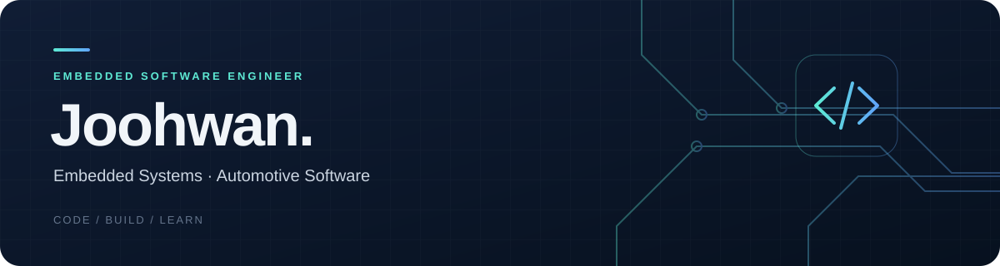

### Embedded & Automotive Software Engineer

에스엘 전장SW설계팀에서 소프트웨어 엔지니어로 일하고 있습니다.  
**C · C++ · Linux · Qt**를 활용한 개발 경험을 바탕으로,  
전장·임베디드 소프트웨어 분야에서 경험을 쌓고 있습니다.

[![Email][gmail-shield]][gmail-url] [![Blog][tistory-shield]][tistory-url] [![LeetCode][leetcode-shield]][leetcode-url] [![Baekjoon][baekjoon-shield]][baekjoon-url]

**[Experience](#-experience) · [Tech Stack](#-tech-stack) · [Education](#-education) · [Publications](#-publications) · [Awards](#-selected-awards)**

---

> **Currently @ 에스엘** · 전장SW설계팀 엔지니어  
> **Focus** · Embedded Software · Automotive Software

## 💼 Experience

| 기간 | 소속 · 역할 |
| --- | --- |
| 2026.09 – 현재 | **에스엘 · 전장SW설계팀 엔지니어** |
| 2026.03 – 2026.08 | 한화비전 VEDA 4기 |
| 2025.01 – 2025.02 | UNIST WebSec · 인턴 |
| 2023.07 – 2025.02 | 한동대학교 MILAB |

---

## 🛠️ Tech Stack

**C / C++**

 

**Tools & Environment**

 

Other Languages

   

---

## 📚 Education

**UNIST · Computer Science and Engineering**  
석사 과정 · 2025.09 – 현재

**Handong Global University · AI·Computer Science**  
학사 · 2019.03 – 2025.02  
🎓 2025.02 · AI·전산전자공학부 **Magna Cum Laude (마그나 쿰 라우데)**

## 📃 Publications

학부 시절 약 1년 반 동안 한영 기계번역 연구에 참여했습니다.

- **한영 번역에서 파라미터 공유 기법을 통한 성능 향상**  
  한국정보과학회 · 2024 한국소프트웨어종합학술대회 논문집 · [논문 ↗][ksc-paper-url]
- **서브워드 방식에 따른 한영 기계번역 성능 및 모델 크기 비교**  
  한국정보과학회 · 2024 한국컴퓨터종합학술대회 논문집 · [논문 ↗][kcc-paper-url]

## 🏆 Selected Awards

| 수상 | 대회 | 시기 |
| :--- | :--- | :--- |
| 🏅 **우수상** | KSC2024 학부생/주니어 논문 경진대회 | 2025.02 |
| 🏆 **최우수상** | KCC2024 학부생/주니어 논문 경진대회 | 2024.07 |
| 🏆 **최우수상** | 전국 대학생 프로그래밍 경진대회 | 2022.11 |

<b>📂 More Awards &amp; Activities</b>

### Awards

- 장려상 · 한동대학교 SW페스티벌 소프트웨어를 활용한 아이디어 공모전 부문 · 2023.11
- 장려상 · 한동대학교 SW페스티벌 스마트 애플리케이션 공모전 부문 · 2022.10
- 장려상 · 대경권 프로그래밍 경진대회 · 2022.05
- 최우수상 · 한동대학교 C프로그래밍 컨테스트 · 2021.12

### Teaching & Leadership

- Discrete Mathematics TA · 2024.09 – 2024.12
- JAVA Programming TA · 2024.03 – 2024.06
- 한동대학교 전산전자공학부 임원단 · 2023.09 – 2024.08
- Discrete Mathematics TA · 2023.09 – 2023.12
- 슬기짜기 동아리 회장 · 2022.08 – 2023.07
- 슬기짜기 동아리 활동 · 2021.09 – 2024.12

[gmail-shield]: https://img.shields.io/badge/Email-18344D?style=for-the-badge&logo=gmail&logoColor=white
[gmail-url]: mailto:a01047286436@gmail.com
[tistory-shield]: https://img.shields.io/badge/Blog-18344D?style=for-the-badge&logo=tistory&logoColor=white
[tistory-url]: https://wnghks7787.tistory.com
[leetcode-shield]: https://img.shields.io/badge/LeetCode-18344D?style=for-the-badge&logo=leetcode&logoColor=%23D16C06
[leetcode-url]: https://leetcode.com/u/wnghks7787/
[baekjoon-shield]: https://img.shields.io/badge/Baekjoon-18344D?style=for-the-badge
[baekjoon-url]: https://www.acmicpc.net/user/wnghks7787/
[ksc-paper-url]: https://www.dbpia.co.kr/pdf/pdfView.do?nodeId=NODE12042287
[kcc-paper-url]: https://www.dbpia.co.kr/pdf/pdfView.do?nodeId=NODE11862425
